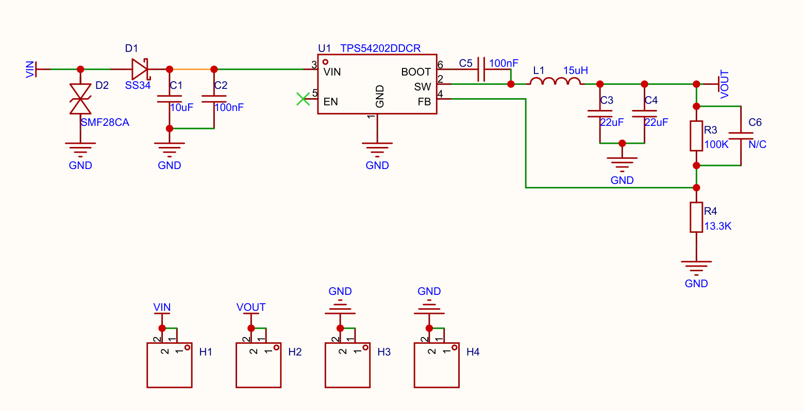
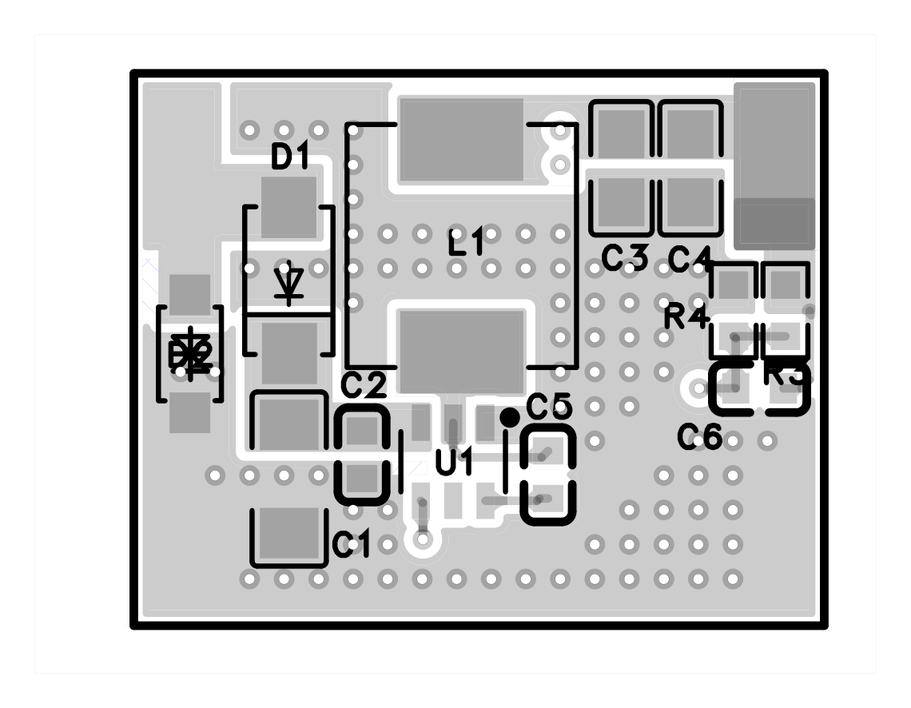
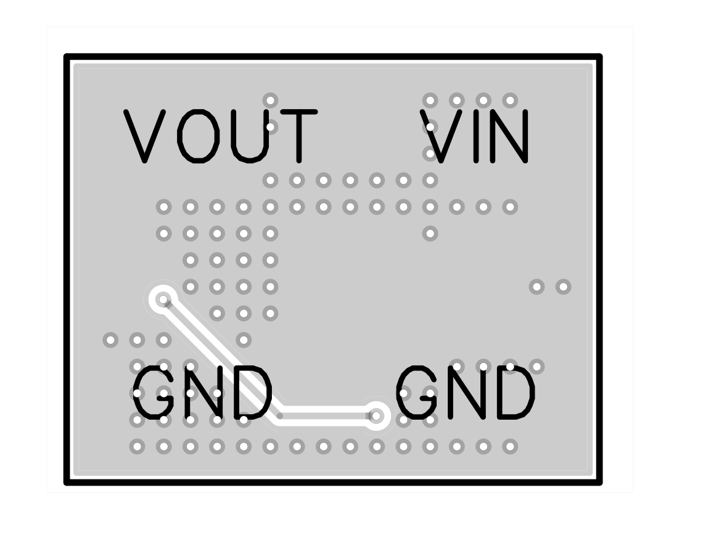

# 我画的第一块 DCDC · 24V 转 5V

基于 **TI TPS54202DDCR** 的同步 Buck 降压板，使用嘉立创 EDA 专业版绘制。记录第一块 DCDC 的原理图、PCB 和设计过程，目标是为灯板等负载提供 5V 电源。

当前发布基准：**TPS54202 DCDC 24-5 396VH real**，于 2026-11-17 从嘉立创 EDA 专业版 V4.1.78 重新导出。



| 项目 | 当前设计 |
| --- | --- |
| 输入 / 输出目标 | 24V DC → 标称 5V DC |
| 核心芯片 | TPS54202DDCR，SOT-23-6，同步降压 |
| 开关频率 | 芯片标称 500kHz |
| 电感 | FXL0630-150-M，15µH |
| 反馈 | R3 = 100kΩ，R4 = 13.3kΩ；按 0.596V 典型参考值计算约 5.08V |
| 板框 | 20.32 × 16.256mm；双层板 |
| 当前验证 | 12 个公共元件、28 个逻辑引脚网络一致；无实测性能数据 |

TPS54202 数据手册给出的芯片输入范围为 4.5～28V、输出能力为 2A；这些是**芯片规格**，本仓库不将其作为本板的实测输入范围、连续负载能力或效率承诺。[TI 数据手册](https://www.ti.com/lit/ds/symlink/tps54202.pdf)

## 下载与打开

- [最新版完整工程 .epro2](hardware/latest/TPS54202_24V_5V_396VH_real.epro2)：包含原理图、PCB、元件库及面板对象；面板对象为空。
- [原理图 PDF](output/pdf/schematic.pdf)：嘉立创原生矢量导出。
- [PCB 与装配 PDF](output/pdf/pcb-current.pdf)：顶面、底面、元件位置、钻孔和重新排版的 BOM，共 5 页。
- [芯片手册 PDF](docs/datasheets/TPS54202_TI_SLVSD26C.pdf)：TI 官方 SLVSD26C，Rev. C，2026-02。
- [PCB BOM](hardware/bom/README.md)、[当前网表](hardware/netlists/README.md)、[版本与差异](docs/version-notes.md)。

在嘉立创 EDA 专业版中使用“文件 → 导入”打开 `.epro2`。完整源工程是继续编辑的入口；PCB PDF 为放大阅读版，不能按 1:1 尺寸使用。

## PCB 预览

| 顶面 | 底面 |
| --- | --- |
|  |  |

接口按 PCB 底面丝印的 `VIN`、`VOUT`、`GND` 识别；观察面不同会造成左右位置翻转。最新版使用板边露铜连接区，原理图中的 H1～H4 排针封装未保留在 PCB 中。

## 电路与当前待核对项

输入经过 SS34 串联二极管，再由 C1（10µF）和 C2（100nF）去耦；TPS54202、L1 和 C3/C4（各 22µF）构成降压主电路。C5 为 BOOT-SW 间的 100nF 自举电容。R3/R4 设置输出，C6 为反馈前馈电容预留位，`N/C` 表示默认不焊。EN 引脚留空，遵循芯片内部上拉使能的使用方式。

以下问题在复刻前需要处理或验证：

1. **原理图接口仍是旧版。** 原理图有 H1～H4，PCB 没有对应封装。12 个公共元件的 28 个引脚网络一致；两侧仍不是完全同步的工程。不要直接把原理图更新到 PCB 后跳过差异确认。
2. **输入 TVS 需要复核。** 当前 D2 为 SMF28CA，工程库标注钳位电压 45.4V；TPS54202 的 VIN 绝对最大额定值为 30V。不能将当前 TVS 宣称为充分的芯片输入过压保护。详见[设计记录](docs/design-notes.md)。
3. **阻容选料尚未完整。** 通用阻容没有完整采购型号，尤其需核对输入电容耐压和 MLCC 直流偏压降容。C6 默认不焊。
4. **实测待补。** 输出误差、纹波、效率、温升、负载阶跃和持续满载均尚无随工程提交的测试记录；ERC/DRC 也未在本次资料整理中完成签核。

## 网表与历史版本

本次重新从最新版原理图导出 `schematic-current.enet`，再从 PCB 的 `PAD_NET` 记录提取 `pcb-current.json`，逐引脚比较。检查结果和输入文件的 SHA-256 保存在 [consistency-report.json](hardware/netlists/consistency-report.json)。该检查只验证逻辑网络分配，不检查铜皮连通、短路、走线间距或电气性能。

最初放入目录的“我画的第一块DCDC.epro2”原样保存为 [历史原理图工程](hardware/history/first-dcdc-schematic.epro2)。它没有 PCB，不应作为最新版打板入口。

重新生成 BOM 和 PCB 网表：

```sh
python tools/export_project.py
```

仓库还保留 [PDF 排版脚本](tools/build_reading_pdf.py)，需要重新在嘉立创导出原生 PCB PDF 至 `tmp/pcb-native.pdf`，并安装 `reportlab`、`PyMuPDF`；脚本默认使用 Windows 黑体。

## 参考资料与许可

资料目录参考了[嘉立创开源的 DCDC 模块](https://oshwhub.com/luchichick/MP1584EN_24v-5v_DCDC)和[电源模块项目](https://oshwhub.com/wuguohao/power-supply-module)对工程、参数、说明和测试状态的组织方式；未复制这些项目的设计文件，也不将其视作本电路的已确认设计来源。

芯片设计与布局核对以 [TPS54202 官方手册](https://www.ti.com/lit/ds/symlink/tps54202.pdf)及 [TI TPS54202EVM-716 评估板资料](https://www.ti.com/tool/TPS54202EVM-716)为依据。评估板测试结果不代表本板性能。

本仓库作者原创设计、文档和脚本以 [MIT License](LICENSE) 开放。TI 手册、嘉立创库符号、封装及其他第三方材料保留原权利人的许可，见 [第三方资料说明](THIRD_PARTY_NOTICES.md)。
